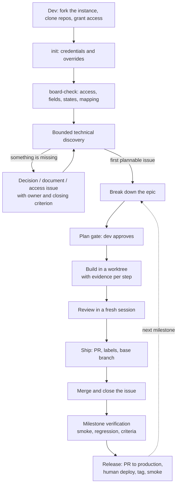

# A board-centered execution harness for AI-assisted delivery

**Status:** design notes from an in-progress rewrite. The harness itself is internal; this document
describes the target design and the decisions behind it. No client code, data or identifiers are
included.

## The problem

Teams adopting coding agents hit the same failure: the work lives in chat. The agent knows what it
was told in this session; the board knows what the project actually needs. Between the two there is
a gap that humans close from memory — until they can't.

Three symptoms:

- **Duplicated or missed work.** Two agents pick the same issue, or nobody picks the one that
  matters.
- **Unverifiable output.** "It works" is a claim, not evidence.
- **Silent degradation.** A guard fails open, and the agent keeps going.

## The thesis

**The board is the single source of truth. The harness is an execution layer: it starts at the board
and ends at the technical release.**

It does not plan, estimate, negotiate scope or report delivery. Those belong to the people who own
the commercial relationship. The harness does the part an agent can be trusted with: understand the
board, fill technical gaps, break work down, gate the plan, build with evidence, review in a fresh
session, ship, verify and release.

One line: *from a harness that produced its own discovery and backlog, to a harness that understands
the project's real board and completes only the technical discovery that implementation needs.*

## Flow

## Contracts

Six contracts, each with an owner and a failure mode.

| Contract | What it fixes | What happens when it breaks |
| --- | --- | --- |
| **Instance** | One root per project; the harness lives there, client repos live outside it | The instance is not ready; init stops |
| **Board** | Provider, project, fields, labels, milestones, canonical states and their mapping | `board-check` returns *no entra* |
| **Repo** | Stack, commands, branches, CI and docs are facts of the repo, not of the harness | The harness obeys the repo; it does not impose its own |
| **External** | Requirements, context and schedule are consumed, never rewritten | The harness blocks and opens a gap issue |
| **Change** | Stable main; one semantic unit per PR; contract changes carry migration notes | The PR is rejected |
| **Record** | State, decisions, evidence and closure live as issue comments | The milestone cannot close |

## Principles

1. **The board rules.** Everything the harness knows about the work is read from the board;
   everything it produces and changes is written there.
2. **The harness does not plan.** It does not estimate, negotiate scope, decide commercial
   priority or produce the client schedule.
3. **Technical discovery belongs to the harness.** Architecture, data model, integrations and the
   role matrix are decisions a PM cannot make and implementation needs.
4. **The board is read as it is.** Nomenclature, states, stages and format are declared per project.
   The default is simple and date-free: `todo`, `in progress`, `blocked`, `done`.
5. **Missing work becomes an issue.** An undecided decision, an unwritten document or an ungranted
   access becomes an issue with an owner and a closing criterion — never a silent assumption.
6. **Quality is not negotiable.** Gate, evidence tied to the tree, fresh-session review and a
   second gate stay with the harness.
7. **The client repo never sees the harness.** Neutral language, project content only; the internal
   record lives on the board.
8. **The default is simple and the project refines it.** The base works without configuration.
   What changes per client is declared after discovery, not guessed before.
9. **The base is stable and updates on purpose.** Every instance is a fork; no update arrives by
   itself.

## What I removed, and why

This is the part I care about most.

v1 tried to own the full lifecycle: planning, estimation, requirements, backlog and delivery
reporting. Every addition was reasonable in isolation. Together they made the system unusable: too
many stages, duplicated rules between `AGENTS.md`, stages and skills, dead references, and a harness
that competed with the PM instead of supporting them.

v2 removes:

- Planning, estimation, scheduling and commercial scope.
- Delivery reporting, client acceptance and the acceptance record.
- Automatic orchestration without human approval.
- Any artifact not tied to a stage and a caller.
- Duplicated rules across instruction files.

The rule that came out of it: **if a file has no stage that consumes it and no skill that calls it,
it is deleted — not archived "just in case".**

A smaller system that people actually use beats a complete system they route around.

## What the gates check

- The branch matches the declared model.
- The plan was approved by the developer before the build.
- Tests pass and evidence is attached per step.
- No secret and no internal vocabulary leaks into the client repo.
- The review ran in a session that did not build the change.
- The issue closes only when the merge happened; a merge into an integration branch does not close
  it by itself.

## Failure is explicit

A missing or failing guard blocks the action. The default is closed, not open.

The same reasoning shows up outside this harness: a stack VM that returns either the resulting state
or an error is easier to trust than one that returns a half-applied state. A system that can
silently produce a nearly-correct result is worse than one that stops and says why.

## Open questions

- How much technical discovery can be delegated before the agent starts inventing requirements?
- What is the smallest evidence format a human will actually read?
- How do you keep the board honest when scope changes mid-milestone?
- Where is the line between "the harness obeys the repo" and "the harness enforces a standard"?
- Is a fork the right distribution model, or does it just move the upgrade problem?

## What this demonstrates

- Design of a multi-agent workflow with explicit contracts instead of prompts.
- Failure semantics and guardrails that are enforced, not documented.
- Scoping judgment: deleting features so the system stays usable.
- Written decision records that survive the session that produced them.

---

*These notes describe a design in progress. The harness is not published; this document is the
public artifact.*
